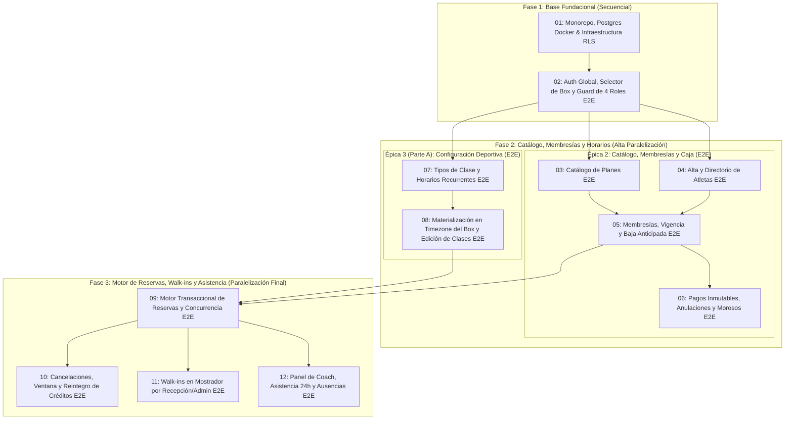

# Plan Maestro E2E (Vertical Slices) — Centris (`centris-app` MVP)

- **Producto**: **Centris** (Sistema de Gestión multitenant alojado en el repositorio **`centris-app`**; el sitio comercial público **`centris-landing`** vive en un repositorio separado fuera de este alcance).
- **PRD de referencia**: [`docs/PRD.md`](../../docs/PRD.md)
- **Modelo de Datos (DER)**: [`docs/DER.md`](../../docs/DER.md)
- **Glosario de Dominio**: [`GLOSSARY.md`](../../GLOSSARY.md)
- **ADRs**: [`docs/adr/0001`](../../docs/adr/0001-identidad-global-con-afiliacion-por-box.md) al [`0007`](../../docs/adr/0007-cuatro-roles-atomicos-componibles.md)

---

## 1. Criterios Técnicos Transversales y Portabilidad (Obligatorios en cada Ticket)

1. **Arquitectura Monorepo (`centris-app`)**:
   - `apps/api`: Backend REST en **NestJS** (TypeScript), 100% portable a cualquier host estándar de Node.js (Render, Railway, Fly.io).
   - `apps/web`: Frontend en **Next.js (App Router)** + **shadcn/ui** + Tailwind CSS, optimizado para despliegue en Vercel o Netlify.
   - `packages/shared`: Esquemas **Zod**, tipos y constantes compartidas de dominio.
2. **Base de Datos, Portabilidad y Aislamiento**:
   - **PostgreSQL estándar**: Ejecución mediante **Docker desde el día 1** para desarrollo local y tests (prohibido usar SQLite o bases en memoria), y compatible sin *vendor lock-in* con proveedores gestionados estándar como **Neon** o **Render** en producción.
   - **ORM**: **Drizzle ORM (`drizzle-orm` + `drizzle-kit` + driver `pg`)** con soporte nativo para abrir transacción y ejecutar `SET LOCAL app.box_id = '<uuid>'` (o `SET LOCAL app.usuario_id = '<uuid>'` en la consulta pre-Box de `Afiliaciones`) antes de cada operación (descartados Prisma y TypeORM).
   - **RLS Forzado**: `ENABLE` y `FORCE ROW LEVEL SECURITY` en todas las tablas operativas del Box; rol de conexión de aplicación sin `BYPASSRLS`. En `afiliaciones`, la política RLS de `SELECT` permite lectura por `app.box_id` o `app.usuario_id`, manteniendo escritura estricta por `app.box_id`.
3. **Autenticación Portable (Mitigación de *Vendor Lock-in*)**:
   - **Auth.js (NextAuth)** con sesión basada en **JWT** en el Frontend (`apps/web`), enviando el token a la API REST de **NestJS** (`apps/api`) donde es validado criptográficamente, evitando el acoplamiento a servicios de identidad propietarios y resolviendo el par `(usuario_id, box_id)` y el array de roles atómicos componibles (`['administrador', 'recepcionista', 'coach', 'atleta']`). Los Usuarios dados de alta por mostrador sin cuenta previa se crean con `password_hash = NULL` y activan su contraseña personal en su primer ingreso.
4. **Calidad, Seguridad, Idioma Ubicuo y Metodología**:
   - **Español de Dominio Ubicuo**: Tablas, columnas de negocio, rutas REST (`/api/planes`, `/api/membresias`), esquemas Zod, clases de dominio y escenarios `.feature` en español respetando el [`GLOSSARY.md`](../../GLOSSARY.md); sufijos técnicos de framework y columnas de auditoría (`id`, `created_at`, `updated_at`, `deleted_at`) en inglés.
   - **Validaciones con Zod** en ambos extremos (`apps/web` y `apps/api`).
   - **Soft Deletes (`deleted_at`)** en todas las entidades maestras y operativas críticas, excepto en `PAGO` (que es inmutable y solo admite `Anulación`).
   - **TDD / BDD y CI en GitHub Actions**: Cada *Vertical Slice* se desarrolla en ciclo *Red $\rightarrow$ Green* usando **`Playwright` + `playwright-bdd`** (`.feature` + `.steps.ts` en español) y **`Vitest`** (`.spec.ts`) contra PostgreSQL real en Docker, validado automáticamente en cada PR mediante `.github/workflows/ci.yml`.

---

## 2. Estructura de Épicas E2E y Mapa de Paralelización

Descartamos el enfoque *backend-first*: cada ticket corta una rebanada vertical completa (**Migración PostgreSQL + RLS $\rightarrow$ API NestJS + Zod $\rightarrow$ UI Next.js + shadcn/ui $\rightarrow$ Tests E2E/Integración**).

### Guía de Ejecución en Paralelo por Fase

| Fase | Tickets que pueden ejecutarse en PARALELO | Justificación de Independencia |
| :--- | :--- | :--- |
| **Fase 1 (Cimientos)** | `01` $\rightarrow$ `02` *(Secuencial)* | Definen el monorepo, el contenedor PostgreSQL con RLS y el contexto `(Usuario, Box, Roles)` requerido por toda la aplicación. |
| **Fase 2A (Arranque Paralelo)** | **`03` $\parallel$ `04` $\parallel$ `07`** *(3 flujos simultáneos)* | `03` (Planes del catálogo), `04` (Directorio de Atletas) y `07` (Tipos de Clase y Horarios) dependen solo de `02` y tocan tablas y pantallas disjuntas. |
| **Fase 2B (Consolidación Paralela)** | **`05` $\parallel$ `08`** *(2 flujos simultáneos)* | Mientras un agente/equipo construye `05` (Asignación de Membresías sobre Planes y Atletas), otro construye `08` (Materialización de Clases desde Horarios). |
| **Fase 3A (Convergencia + Caja en Paralelo)** | **`06` $\parallel$ `09`** *(2 flujos simultáneos)* | Gracias al [ADR 0006](../../docs/adr/0006-acceso-desacoplado-del-pago.md) (acceso desacoplado del pago), `06` (Pagos inmutables, Anulaciones y Morosos) puede desarrollarse en paralelo con `09` (Motor de Reservas ACID). |
| **Fase 3B (Cierre Operativo en Paralelo)** | **`10` $\parallel$ `11` $\parallel$ `12`** *(3 flujos simultáneos)* | Una vez listo el alta de Reserva (`09`), se pueden desarrollar en paralelo `10` (Cancelaciones y reintegros), `11` (Walk-ins de mostrador) y `12` (Asistencia del Coach y cierre de Ausencias a las 24 hs). |

---

## 3. Índice de Tickets (*Vertical Slices*)

### Épica 1: Setup Core Monorepo, Postgres Docker & Auth E2E
- [01: Cimientos del Monorepo, PostgreSQL en Docker e Infraestructura RLS](./issues/01-monorepo-postgres-rls-foundation.md) — **Blocked by:** None
- [02: Identidad Global, Autenticación, Selector de Box y Guard de 4 Roles Componibles E2E](./issues/02-auth-selector-box-y-roles-e2e.md) — **Blocked by:** `01`

### Épica 2: Gestión de Catálogo, Membresías y Caja Inmutable (E2E)
- [03: Catálogo de Planes Comerciales E2E](./issues/03-catalogo-planes-e2e.md) — **Blocked by:** `02` *(Paralelizable con `04` y `07`)*
- [04: Alta y Directorio de Atletas por Recepción y Administración E2E](./issues/04-directorio-y-alta-atletas-e2e.md) — **Blocked by:** `02` *(Paralelizable con `03` y `07`)*
- [05: Asignación de Membresías, Renovaciones, Ajustes y Baja Anticipada E2E](./issues/05-membresias-vigencia-y-baja-anticipada-e2e.md) — **Blocked by:** `03`, `04` *(Paralelizable con `07` y `08`)*
- [06: Caja Contable de Pagos Inmutables, Anulaciones Auditables y Reporte de Morosos E2E](./issues/06-pagos-inmutables-anulaciones-y-morosos-e2e.md) — **Blocked by:** `05` *(Paralelizable con `08` y `09`)*

### Épica 3: Operativa Deportiva — Horarios, Clases, Reservas y Asistencias (E2E)
- [07: Tipos de Clase y Grilla de Horarios Recurrentes E2E](./issues/07-tipos-clase-y-horarios-recurrentes-e2e.md) — **Blocked by:** `02` *(Paralelizable con `03`, `04`, `05`, `06`)*
- [08: Materialización de Clases en Zona Horaria del Box y Edición Manual de Clases E2E](./issues/08-materializacion-y-edicion-clases-e2e.md) — **Blocked by:** `07` *(Paralelizable con `05` y `06`)*
- [09: Motor Transaccional de Reservas del Atleta y Control de Concurrencia E2E](./issues/09-motor-reservas-atleta-concurrencia-e2e.md) — **Blocked by:** `05`, `08` *(Paralelizable con `06`)*
- [10: Cancelación de Reservas, Cancelación Tardía, Liberación sin Waitlist y Cancelación de Clase por el Box E2E](./issues/10-cancelaciones-ventana-y-reintegro-creditos-e2e.md) — **Blocked by:** `09` *(Paralelizable con `11` y `12`)*
- [11: Gestión de Walk-ins en Mostrador por Recepción y Administración E2E](./issues/11-walk-ins-mostrador-recepcion-e2e.md) — **Blocked by:** `09` *(Paralelizable con `10` y `12`)*
- [12: Panel del Coach, Marcado de Asistencia, Ventana de 24 hs y Consolidación de Ausencias E2E](./issues/12-asistencia-coach-y-consolidacion-ausencias-e2e.md) — **Blocked by:** `09` *(Paralelizable con `10` y `11`)*
