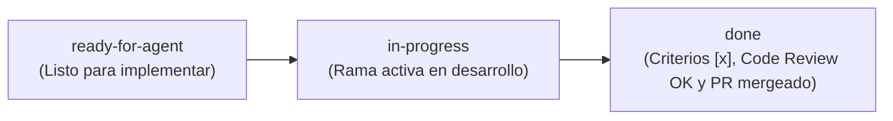

# Guía de Contribución, Flujo de Git y Ciclo de Tickets (`centris-app`)

Este documento define las convenciones de ramas (*branches*), mensajes de commit, ciclo de vida de los tickets en [`.scratch/mvp/issues/`](../.scratch/mvp/issues/), flujo de pruebas TDD/BDD y la **Definición de Hecho (*Definition of Done — DoD*)** obligatoria para cada Pull Request.

---

## 1. Convención de Ramas (*Branches*)

La rama principal e integrable del repositorio es **`main`**, protegida por el pipeline de Integración Continua (`.github/workflows/ci.yml`).

| Tipo de Trabajo | Formato de la Rama | Ejemplo |
| :--- | :--- | :--- |
| **Implementación de Ticket E2E** | `feat/<NN>-<slug>` *(idéntico al archivo en `.scratch/mvp/issues/`)* | `feat/01-monorepo-postgres-rls-foundation`<br>`feat/09-motor-reservas-atleta-concurrencia-e2e` |
| **Subdivisión de un Ticket (Opcional)** | `feat/<NN><letra>-<sub-slug>` | `feat/05a-alta-y-renovacion-membresias` |
| **Corrección de Bug** | `fix/<dominio>-<descripcion-corta>` | `fix(reservas)-calculo-timezone-domingo` |
| **Documentación / Configuración** | `docs/<descripcion>` o `chore/<descripcion>` | `chore/architecture-setup` |

---

## 2. Convención de Commits (*Conventional Commits*)

Todos los mensajes de commit siguen el estándar **Conventional Commits** en **español**, utilizando el término del dominio en minúsculas como `<scope>`:

```text
<tipo>(<alcance>): <descripción breve en infinitivo o sustantivo sin punto final>
```

### Tipos permitidos
- **`test`**: Agrega o actualiza pruebas en ciclo *Red* de TDD (`.feature`, `.steps.ts` o `.spec.ts`).
- **`feat`**: Implementa comportamiento de negocio, migración, endpoint o pantalla para pasar el test (*Green*).
- **`fix`**: Corrige un defecto de comportamiento o regresión.
- **`refactor`**: Mejora la estructura interna sin alterar el comportamiento observable (etapa de `/code-review`).
- **`docs`**: Cambios exclusivos en documentación (`docs/`, `GLOSSARY.md`, `AGENTS.md`, `README.md`).
- **`chore`**: Configuración de tooling, dependencias, scripts de Docker o CI/CD.

### Ejemplos de commits atómicos dentro de un Ticket
Durante la ejecución de `/implement` (que conduce `/tdd` un criterio `- [ ]` a la vez), se recomienda realizar un commit por cada criterio de aceptación completado:
1. `feat(planes): crear tabla planes con force rls y esquema zod`
2. `feat(planes): implementar abm de planes para administrador y lectura para recepcionista`
3. `test(planes): verificar aislamiento rls de planes entre boxes distintos`

---

## 3. Ciclo de Vida de los Tickets

Los tickets viven en [`.scratch/mvp/issues/`](../.scratch/mvp/issues/) y utilizan el vocabulario de estados documentado en [`docs/agents/triage-labels.md`](./agents/triage-labels.md):



1. **`ready-for-agent`**: El ticket está completamente especificado y todos los tickets listados en su campo `Blocked by:` ya están en estado `done`.
2. **`in-progress`**: Al comenzar a trabajar el ticket en su rama `feat/<NN>-<slug>`, se actualiza la línea `**Status:** in-progress` en el archivo del ticket.
3. **`done`**: Cuando todos los checkboxes `- [x]` de `## Acceptance Criteria (TDD / BDD)` están cumplidos y verificados, se actualiza `**Status:** done` en el último commit antes de abrir/mergear el Pull Request.

---

## 4. Flujo de Trabajo Paso a Paso por Ticket

1. **Preparar sesión y rama**:
   - Abrir una sesión de agente limpia (`/clear` o nueva conversación).
   - Desde `main` actualizada, crear la rama `git checkout -b feat/<NN>-<slug>`.
2. **Invocar `/implement` (o `/tdd`)**:
   - Ejecutar `/implement .scratch/mvp/issues/<NN>-<slug>.md`.
   - Acordar con el agente las costuras de prueba (*seams*): escenarios BDD en **`playwright-bdd`** (`.feature` + `.steps.ts`) y pruebas focalizadas/concurrencia en **`Vitest`** (`.spec.ts`).
   - Construir un criterio `- [ ]` a la vez siguiendo el ciclo **Red $\rightarrow$ Green**.
3. **Ejecutar Revisión en Doble Eje (`/code-review`)**:
   - Comparar `git diff main...HEAD` con `/code-review`, que lanza dos subagentes en paralelo:
     - **Standards**: verifica el cumplimiento de [`GLOSSARY.md`](../GLOSSARY.md), [`docs/ARCHITECTURE.md`](./ARCHITECTURE.md), [`docs/DESIGN_SYSTEM.md`](./DESIGN_SYSTEM.md) y este documento.
     - **Spec**: verifica el cumplimiento íntegro del ticket en `.scratch/mvp/issues/<NN>-<slug>.md`.
4. **Pull Request y Merge**:
   - Subir la rama a GitHub, abrir el Pull Request hacia `main`, aguardar el check verde de **GitHub Actions CI** y realizar el merge.

---

## 5. Definición de Hecho (*Definition of Done — DoD*)

Ningún ticket se considera `done` ni puede mergearse a `main` si no cumple **todos** los siguientes puntos:

- [ ] **Lenguaje Ubicuo**: Todos los identificadores de dominio, tablas, endpoints y textos de UI respetan [`GLOSSARY.md`](../GLOSSARY.md) sin usar ninguno de los términos listados en `_Avoid_`.
- [ ] **Seguridad Multi-tenant (RLS)**: Toda tabla operativa nueva tiene `ENABLE` y `FORCE ROW LEVEL SECURITY`, claves foráneas compuestas `(box_id, <entidad>_id)` y al menos un escenario de prueba que verifica que `Box A` no puede leer ni escribir datos de `Box B`.
- [ ] **Criterios de Aceptación en `[x]`**: Todos los escenarios *Given / When / Then* del ticket están implementados y pasando en verde contra PostgreSQL real en Docker.
- [ ] **Comandos de Calidad en Verde**:
  - `pnpm lint` (sin errores de ESLint).
  - `pnpm typecheck` (compilación estricta de TypeScript en `packages/shared`, `apps/api` y `apps/web`).
  - `pnpm test` (`Vitest` + `playwright-bdd` pasando al 100%).
- [ ] **Revisión `/code-review` aprobada** en ambos ejes (*Standards* y *Spec*).
- [ ] **Pipeline `.github/workflows/ci.yml` en verde** en el Pull Request de GitHub.
