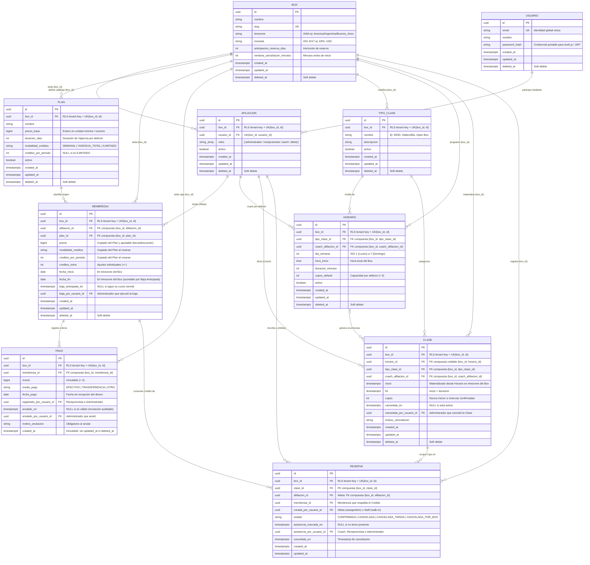

# Diagrama de Entidad-Relación (DER) — Centris (`centris-app` MVP)

Este documento describe el modelo de datos relacional en **PostgreSQL** para el MVP de **Centris** (`centris-app`), alineado con el [`GLOSSARY.md`](../GLOSSARY.md), el [`PRD.md`](./PRD.md) y los registros de decisión arquitectónica ([ADR 0001](./adr/0001-identidad-global-con-afiliacion-por-box.md) al [ADR 0007](./adr/0007-cuatro-roles-atomicos-componibles.md)).

---

## 1. Diagrama Mermaid (`erDiagram`)



---

## 2. Reglas Estructurales del Esquema en PostgreSQL

### 2.1. Aislamiento Multi-tenant y Row Level Security ([ADR 0004](./adr/0004-aislamiento-por-box-con-rls-en-postgresql.md))
- **Tablas Globales (sin RLS)**: `USUARIO` y `BOX`.
- **Tablas Operativas del Box (con `FORCE ROW LEVEL SECURITY`)**: `AFILIACION`, `PLAN`, `MEMBRESIA`, `PAGO`, `TIPO_CLASE`, `HORARIO`, `CLASE`, `RESERVA`.
- **Política RLS Canónica**:
  ```sql
  ALTER TABLE <tabla> ENABLE ROW LEVEL SECURITY;
  ALTER TABLE <tabla> FORCE ROW LEVEL SECURITY;

  CREATE POLICY box_isolation_policy ON <tabla>
    USING (box_id = current_setting('app.box_id', true)::uuid)
    WITH CHECK (box_id = current_setting('app.box_id', true)::uuid);
  ```
- **Claves Foráneas Compuestas Intra-Box**:
  Cada tabla operativa expone una restricción única `UNIQUE (box_id, id)` y todas las claves foráneas entre tablas operativas referencian el par `(box_id, <entidad>_id)`. Esto garantiza a nivel de motor que una `RESERVA` del `Box A` jamás pueda apuntar a una `CLASE` o `MEMBRESIA` del `Box B`.

### 2.2. Integridad, Soft Deletes e Inmutabilidad Contable
- **Soft Deletes (`deleted_at`)**: Presente en entidades maestras y configurables (`USUARIO`, `BOX`, `AFILIACION`, `PLAN`, `MEMBRESIA`, `TIPO_CLASE`, `HORARIO`, `CLASE`) para preservar la integridad histórica de reportes, asistencias y auditoría sin romper referencias foráneas.
- **Inmutabilidad de `PAGO` ([ADR 0006](./adr/0006-acceso-desacoplado-del-pago.md))**: La tabla `PAGO` **no** utiliza `deleted_at` ni permite `UPDATE` de importes. Un pago erróneo solo admite poblar los campos de **Anulación** (`anulado_en`, `anulado_por_usuario_id`, `motivo_anulacion`).
- **Campos Calculados (No Persistidos)**:
  - **Saldo de Membresía**: `membresia.precio - COALESCE(SUM(pago.monto) FILTER (WHERE pago.anulado_en IS NULL), 0)`.
  - **Estado de Moroso**: Atleta que posee al menos una `MEMBRESIA` no eliminada con `Saldo > 0`.
  - **Ausencia Consolidada**: Toda `RESERVA` con `estado = 'CONFIRMADA'`, `asistencia_marcada_en IS NULL` y donde la hora actual supere `clase.fin + INTERVAL '24 hours'` (Ventana de Corrección de Asistencia vencida).

### 2.3. Constraints de Concurrencia ([ADR 0003](./adr/0003-integridad-de-cupos-y-creditos-en-base-de-datos.md))
- **Unicidad de Reserva Activa**: Índice único parcial `CREATE UNIQUE INDEX uq_reserva_activa ON reservas (box_id, clase_id, afiliacion_id) WHERE estado = 'CONFIRMADA'`.
- **No Superposición de Membresías Vigentes**: Constraint de exclusión GiST (`btree_gist`) sobre `(box_id, afiliacion_id, daterange(fecha_inicio, fecha_fin, '[]')) WHERE deleted_at IS NULL` para garantizar como máximo una `MEMBRESIA` vigente por Atleta en cualquier fecha calendario.
- **Validación Transaccional con `SELECT ... FOR UPDATE`**: En el alta de `RESERVA`, se bloquea primero la fila en `MEMBRESIA` y segundo la fila en `CLASE` dentro de la misma transacción.
