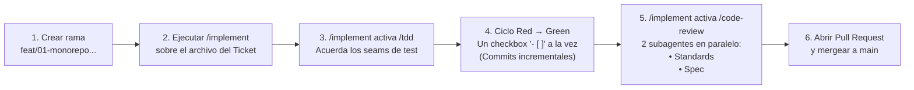

# Guía de Uso de Skills (Matt Pocock), Estrategia de Ramas/Tickets y Seguimiento en Kanban (`centris-app`)

Este documento explica cómo opera el conjunto de **skills de ingeniería de Matt Pocock** configuradas en este repositorio, cómo se estructuran las sesiones de trabajo con agentes, cómo gestionar las ramas (*branches*), commits y *Pull Requests* sobre los 12 tickets del MVP, y cómo mapear todo el flujo en un tablero Kanban (**Jira** o **GitHub Projects**) para la entrega académica de **Proyecto Integrador**.

---

## 1. Cómo funciona el set de Skills instaladas

Las skills viven en [`.agents/skills/`](../.agents/skills/) y la configuración específica de este repositorio está declarada en [`AGENTS.md`](../AGENTS.md), [`docs/agents/issue-tracker.md`](./agents/issue-tracker.md) y [`docs/agents/domain.md`](./agents/domain.md).

Existen **dos categorías** de skills según quién las invoca:

### A. Skills de Flujo (Invocadas explícitamente por el desarrollador con `/comando`)
Tienen `disable-model-invocation: true` en su definición para garantizar que el agente nunca cambie de fase sin tu confirmación explícita:

| Skill | Propósito en el flujo de trabajo | Salida en el repositorio |
| :--- | :--- | :--- |
| **`/setup-matt-pocock-skills`** | Configura por única vez dónde viven los tickets y los documentos de dominio. | [`AGENTS.md`](../AGENTS.md) y [`docs/agents/`](./agents/) |
| **`/grill-with-docs`** | Entrevista iterativa implacable (usando `/grilling` + `/domain-modeling`) para eliminar ambigüedades de diseño. | [`GLOSSARY.md`](../GLOSSARY.md) y ADRs en [`docs/adr/`](./adr/) |
| **`/to-spec`** | Sintetiza lo acordado en una especificación completa con historias de usuario, decisiones de implementación y costuras de prueba (*testing seams*). | [`.scratch/mvp/spec.md`](../.scratch/mvp/spec.md), [`docs/PRD.md`](./PRD.md), [`docs/DER.md`](./DER.md) |
| **`/to-tickets`** | Parte la especificación en rebanadas verticales E2E (*tracer bullets*), declarando sus dependencias (`Blocked by`). | [`.scratch/mvp/issues/01..12.md`](../.scratch/mvp/issues/) |
| **`/implement`** | Toma un ticket listo (`ready-for-agent`), conduce su construcción mediante `/tdd`, ejecuta la suite de pruebas y cierra con `/code-review`. | Código fuente, migraciones, tests y commit en la rama activa |
| **`/ask-matt`** | Mapa de orientación para consultar qué skill usar en cada momento o cómo manejar los límites de fase. | Respuesta orientativa en el chat |

### B. Disciplinas y Vocabularios de Fondo (Invocadas por el agente o manualmente)
Corren por debajo de las skills de flujo (aunque también podés invocarlas directamente con `/comando` cuando quieras forzarlas):

* **`/grilling`**: Primitiva de entrevista por rondas. Mapea las decisiones pendientes como un árbol (*frontier*), investiga por su cuenta los hechos técnicos del repositorio y te pregunta únicamente las decisiones de diseño proponiendo una respuesta recomendada.
* **`/domain-modeling`**: Mantiene limpio el lenguaje ubicuo en [`GLOSSARY.md`](../GLOSSARY.md) (sin detalles de implementación filtrados y con términos prohibidos bajo `_Avoid_`) y redacta ADRs en [`docs/adr/`](./adr/) solo para decisiones difíciles de revertir y con *trade-offs* reales.
* **`/codebase-design`**: Vocabulario de diseño de **módulos profundos** (*deep modules*: mucha funcionalidad detrás de una interfaz pequeña ubicada en una costura o *seam* limpio).
* **`/tdd`**: Disciplina estricta de ciclo **Red $\rightarrow$ Green**, escribiendo pruebas únicamente sobre las costuras públicas acordadas (*seams*) y verificando comportamiento observable (nunca detalles internos ni tests tautológicos).
* **`/code-review`**: Revisión automatizada del `git diff` mediante **2 subagentes en paralelo**:
  1. **Eje *Standards***: Verifica que el código cumpla los estándares documentados del repositorio y no introduzca *code smells* de Fowler.
  2. **Eje *Spec***: Verifica que el código cumpla todos los criterios del ticket sin faltantes ni agregado de alcance no pedido (*scope creep*).

---

## 2. Higiene de Contexto y Manejo de Sesiones (*Phase Boundaries*)

Según [`.agents/skills/ask-matt/PHASE-BOUNDARIES.md`](../.agents/skills/ask-matt/PHASE-BOUNDARIES.md), el manejo de las ventanas de contexto se rige por dos reglas:

1. **Etapa de Diseño (`grill-with-docs` $\rightarrow$ `to-spec` $\rightarrow$ `to-tickets`)**:
   * Se mantiene idealmente en **una misma ventana de contexto** para que la especificación y los tickets conserven todo el razonamiento como fuente primaria (*primary source*).
   * Como `/grill-with-docs` persiste el estado en [`GLOSSARY.md`](../GLOSSARY.md) y [`docs/adr/`](./adr/) en tiempo real, cualquier ajuste posterior (como los pendientes de [`docs/feedback-revision.md`](./feedback-revision.md)) se apoya directamente sobre esos archivos en disco.
2. **Etapa de Construcción (Ticket `01`, Ticket `02`, ..., Ticket `12`)**:
   * **Cada ticket se ejecuta en una sesión nueva y limpia (`/clear` o nueva conversación).**
   * Como cada archivo en `.scratch/mvp/issues/` es autocontenido y el repositorio cuenta con el glosario, ADRs, PRD y DER, el historial de conversación del Ticket `01` es descartable al pasar al Ticket `02`. Esto garantiza que el modelo trabaje siempre dentro de su zona de máxima capacidad de razonamiento (*smart zone*).

---

## 3. Estructura de 3 Niveles: Épicas, Tickets (*Vertical Slices*) y Subtareas TDD

Los 12 archivos generados por `/to-tickets` en [`.scratch/mvp/issues/`](../.scratch/mvp/issues/) **no son épicas**, sino **Historias / Tickets E2E (*Vertical Slices*)**. La jerarquía completa del proyecto tiene **3 niveles**:

| Nivel en Gestión de Proyecto | Representación en el Repositorio | Cantidad | Descripción |
| :--- | :--- | :---: | :--- |
| **Nivel 1: Épicas (*Epics*)** | Secciones de [`.scratch/mvp/spec.md`](../.scratch/mvp/spec.md#L89-L107) | **3 Épicas** | **Épica 1**: Setup Core Monorepo, Postgres Docker & Auth E2E<br>**Épica 2**: Catálogo, Membresías y Caja Inmutable E2E<br>**Épica 3**: Operativa Deportiva (Horarios, Clases, Reservas y Asistencias E2E) |
| **Nivel 2: Tickets / Historias E2E (*Vertical Slices*)** | Archivos `01-*.md` a `12-*.md` en [`.scratch/mvp/issues/`](../.scratch/mvp/issues/) | **12 Tickets** | Cada archivo corta una **rebanada vertical completa** a través de todas las capas (Migración PostgreSQL + RLS $\rightarrow$ API NestJS + Zod $\rightarrow$ UI Next.js + `shadcn/ui` $\rightarrow$ Tests E2E). Al completarse, es demostrable por sí mismo. |
| **Nivel 3: Subtareas / Escenarios BDD** | Checkboxes `- [ ]` bajo `## Acceptance Criteria (TDD / BDD)` dentro de cada ticket | **~52 Subtareas** *(4 a 5 por ticket)* | Cada checkbox `- [ ]` en formato *Given / When / Then* representa una unidad de trabajo del loop **Red $\rightarrow$ Green** de `/tdd`. |

> [!IMPORTANT]
> **Por qué se usan *Vertical Slices* y se prohíbe el *Horizontal Slicing*:**
> Dividir tickets por capa técnica (ej. *"Ticket A: crear todas las tablas"*, *"Ticket B: crear todos los endpoints"*, *"Ticket C: crear todas las pantallas"*) retrasa la integración hasta el final y genera código que no se puede probar de punta a punta. Con *Vertical Slices*, desde el Ticket `01` y `02` el sistema compila, levanta en Docker y valida cada regla de negocio de principio a fin.

---

## 4. Cómo operan `/implement`, `/tdd` y `/code-review` sobre cada Ticket

Cuando iniciás la construcción de un ticket (por ejemplo, el Ticket `01`), el ciclo interno funciona así:



1. **Inicio**: En una sesión limpia, ejecutás:
   ```text
   /implement .scratch/mvp/issues/01-monorepo-postgres-rls-foundation.md
   ```
2. **Acuerdo de costuras (*Seams*)**: `/implement` invoca a `/tdd`. Antes de escribir código, el agente te propone en qué costura pública (*seam*) se van a conectar los tests de ese ticket y espera tu confirmación.
3. **Iteración checkbox por checkbox (*Red $\rightarrow$ Green*)**:
   * Toma el **primer criterio `- [ ]`** del ticket.
   * Escribe el test automatizado que falla (**Red**).
   * Escribe únicamente el código necesario para pasar ese test (**Green**).
   * Ejecuta el chequeo de tipos y el test, marca el criterio `- [x]` y pasa al siguiente checkbox `- [ ]` del ticket.
4. **Cierre y Revisión en Doble Eje**:
   * Una vez completados todos los criterios del ticket y con toda la suite de tests en verde, `/implement` invoca automáticamente a **`/code-review`**.
   * `/code-review` compara tu rama contra `main` usando dos subagentes en paralelo (**Standards** y **Spec**). Si detectan alguna desviación, se corrige antes de abrir el Pull Request.

---

## 5. Estrategias para Ramas (*Branches*), Pull Requests y Subdivisión de Tickets

Para trabajar con GitHub y Pull Requests de forma ordenada y trazable, podés aplicar dos estrategias complementarias:

### Estrategia 1 (Estándar recomendada): 1 Branch y 1 PR por cada uno de los 12 Tickets
* **Rama**: Creás una rama por cada archivo en `.scratch/mvp/issues/`, por ejemplo:
  * `feat/01-monorepo-postgres-rls-foundation`
  * `feat/02-auth-selector-box-y-roles-e2e`
* **Subdivisión interna mediante Commits**: Dentro de esa rama, cada vez que completás uno de los 4 o 5 criterios de aceptación (`- [ ]`) con `/tdd`, realizás un **commit atómico** (siguiendo *Conventional Commits*).
* **Pull Request**: Al completar los criterios del ticket y pasar `/code-review`, abrís **1 Pull Request** hacia `main`.
* **Ventaja**: Tus profesores (y cualquier revisor) verán 12 Pull Requests limpios donde cada PR entrega un módulo E2E funcional, y dentro de cada PR verán los commits paso a paso de cada ciclo TDD.

### Estrategia 2 (Para tickets extensos): Subdivisión en múltiples sesiones o sub-tickets
Si al llegar a un ticket con mucha lógica de negocio (como el [Ticket 05](../.scratch/mvp/issues/05-membresias-vigencia-y-baja-anticipada-e2e.md) o el [Ticket 09](../.scratch/mvp/issues/09-motor-reservas-atleta-concurrencia-e2e.md)) preferís dividirlo en entregas más chicas, tenés dos opciones:

1. **Ejecutar `/tdd` sobre un subconjunto de criterios del ticket**:
   En lugar de correr `/implement` sobre todo el ticket de una vez, invocás directamente `/tdd` indicándole qué checkboxes resolver en esa sesión/rama:
   > *"`/tdd` Sobre el Ticket `05`, implementemos en esta rama únicamente los criterios 1 y 2 (alta de Membresía y constraint GiST de no superposición)."*
   Al terminar esos criterios, corrés `/code-review`, abrís el PR, y en la siguiente sesión abordás los criterios restantes (Renovación y Baja Anticipada).
2. **Partir el archivo con `/to-tickets`**:
   Podés pedirle a `/to-tickets` que divida un ticket complejo en dos archivos (`05a-...md` y `05b-...md`), cuidando siempre que ambos sigan siendo rebanadas verticales E2E (nunca separar "solo base de datos" de "solo interfaz").

---

## 6. Consejo Práctico para Jira / GitHub Projects (Materia Proyecto Integrador)

Para cumplir con el requisito académico de seguimiento en tablero Kanban sin duplicar esfuerzo ni perder la integración con las skills locales:

### Opción A: Si podés elegir la herramienta $\rightarrow$ **GitHub Projects (vista Kanban + Roadmap)**
* Creás un tablero **GitHub Project** vinculado a este repositorio.
* Cada uno de los 12 tickets se carga como un **GitHub Issue** agrupado bajo un campo personalizado `Épica` (*Épica 1*, *Épica 2*, *Épica 3*), y con sus checkboxes `- [ ]` como *Tasklist* dentro del cuerpo del Issue.
* **Ventaja**: Cuando abrís un Pull Request con `Closes #1` en GitHub, la tarjeta del Kanban se mueve automáticamente de `In Progress` $\rightarrow$ `In Review` $\rightarrow$ `Done` al mergear. Además, `/setup-matt-pocock-skills` incluye soporte nativo para GitHub Issues ([`issue-tracker-github.md`](../.agents/skills/setup-matt-pocock-skills/issue-tracker-github.md)).

### Opción B: Si la cátedra exige específicamente **Jira (Atlassian)**
* Mantenés los archivos `.scratch/mvp/issues/01..12.md` dentro del repositorio para que los agentes (`/implement`, `/tdd`, `/code-review`) trabajen a máxima velocidad leyendo los archivos locales versionados en Git.
* En **Jira**, reflejás exactamente la estructura de 3 niveles que ya tenés redactada:
  1. Creás las **3 Épicas** (*Setup Core & Auth*, *Catálogo, Membresías y Caja*, *Operativa Deportiva*).
  2. Creás las **12 Historias (*Stories*)** vinculadas a sus respectivas Épicas (una por cada archivo `01` a `12`).
  3. Dentro de cada Historia en Jira, cargás los **4–5 criterios de aceptación** como **Subtareas (*Sub-tasks*)**.
* **Trazabilidad entre Jira y GitHub**: Si tu proyecto en Jira tiene clave `CEN`, podés incluir el código de Jira en el nombre de la rama o en los commits (por ejemplo `feat/01-monorepo-postgres-rls` o `feat(rls): CEN-1 configurar force rls en afiliaciones`), dejando vinculados el tablero Kanban de Jira, los Pull Requests de GitHub y la especificación en `.scratch/mvp/`.
